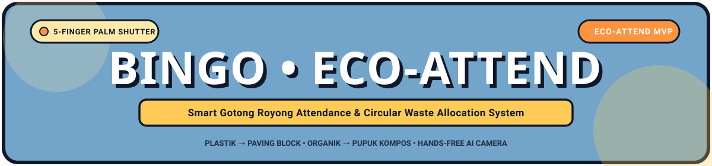
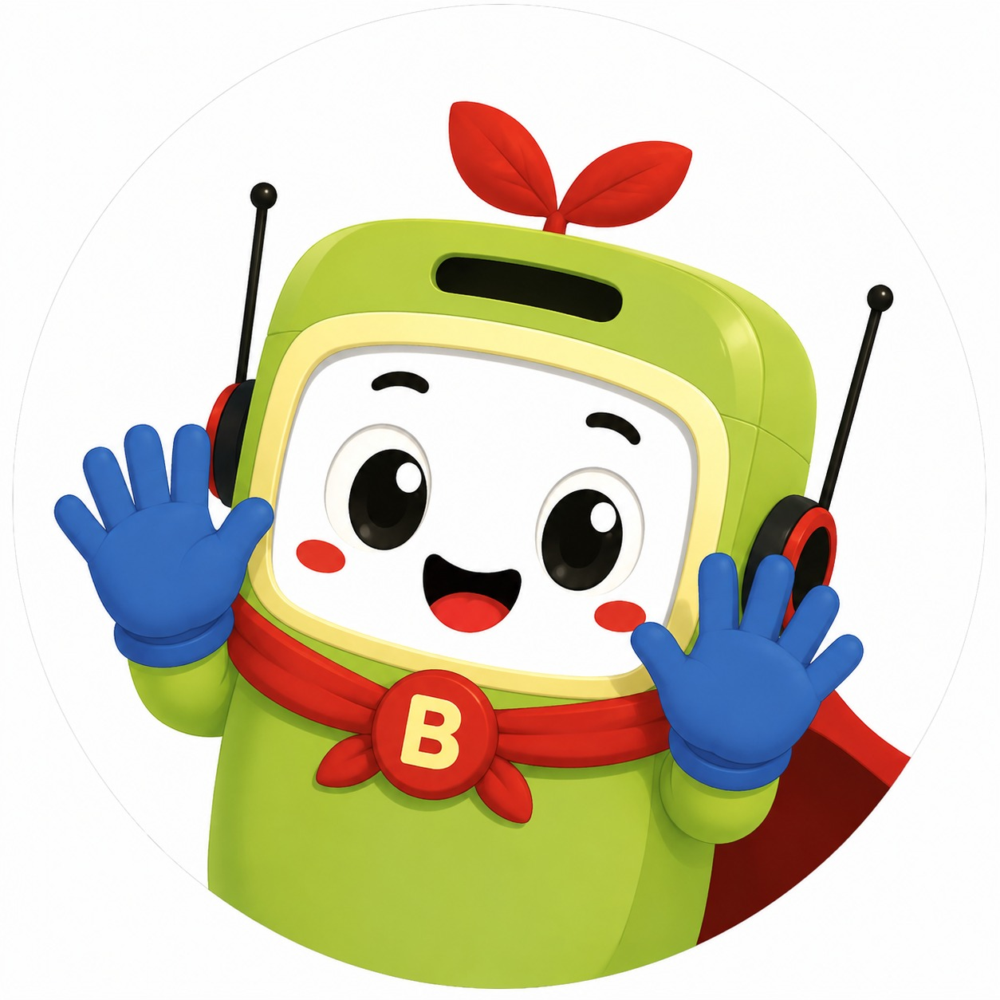

<div align="center">
  
</div>

<br/>

<!-- Animasi Teks Mengetik -->
<div align="center">
  
</div>

<br/>

<!-- Badges Tech Stack -->
<div align="center">
  
  
  
  
  
</div>

<br/>

<!-- Hero Split Section: Maskot BinBin + Ringkasan Eksekutif -->
<table>
  <tr>
    <td width="240" align="center">
      
      <br/>
      <sub><b>Maskot Resmi: BinBin</b></sub>
    </td>
    <td>
      <h3>Tentang BINGO (ECO-ATTEND)</h3>
      <p>
        <b>BINGO (ECO-ATTEND)</b> adalah prototipe <i>Minimum Viable Product (MVP)</i> berbasis web yang mengubah sistem absensi kertas kegiatan <b>gotong royong RT/RW</b> menjadi sistem digital berbasis bukti foto wajah dan alokasi daur ulang sampah terpilah.
      </p>
      <p>
        Dirancang khusus untuk kondisi lapangan: warga yang tangannya sedang memegang kantong sampah cukup <b>mengangkat 5 jari terbuka</b> di depan kamera laptop untuk memicu hitung mundur foto otomatis 5 detik tanpa menyentuh perangkat (<i>hands-free</i>).
      </p>
    </td>
  </tr>
</table>

---

## Fitur Unggulan MVP

<table>
  <tr>
    <td width="50%" valign="top">
      <h4>🖐️ Hands-Free 5-Finger Palm Shutter</h4>
      <p>Ditenagai <b>Google MediaPipe HandLandmarker</b> yang memindai 21 titik sendi tangan secara <i>real-time</i> di browser. Saat 5 jari terbuka terdeteksi, timer <b>5 detik</b> berjalan otomatis sebelum mengambil bukti foto wajah.</p>
    </td>
    <td width="50%" valign="top">
      <h4>♻️ Kalkulator Circular Economy</h4>
      <p>Setiap kilogram sampah terpilah langsung dikonversi menjadi proyeksi produk bermanfaat bagi lingkungan RT/RW:</p>
      <ul>
        <li><b>1 kg Plastik</b> → <code>2 pcs Paving Block</code></li>
        <li><b>1 kg Organik</b> → <code>0,5 kg Pupuk Kompos</code></li>
      </ul>
    </td>
  </tr>
  <tr>
    <td width="50%" valign="top">
      <h4>🏷️ Tactile Poster UI & Menu "PULL ME"</h4>
      <p>Mengusung estetika <i>neo-brutalist / tactile sticker</i> dengan kontras tinggi agar mudah dibaca di luar ruangan, dilengkapi menu navigasi tarik interaktif di pojok kanan atas.</p>
    </td>
    <td width="50%" valign="top">
      <h4>📊 Log Bukti Foto & Export CSV</h4>
      <p>Data kehadiran tersimpan otomatis di browser (<code>localStorage</code>) lengkap dengan thumbnail foto warga, serta dapat diunduh menjadi laporan <code>.csv</code> siap buka di Microsoft Excel.</p>
    </td>
  </tr>
</table>

---

## Arsitektur & Alur Kerja Sistem

```mermaid
flowchart LR
    A[Warga Bawa Sampah] --> B{Pilah Kategori}
    B -->|Plastik| C[Alokasi Paving Block]
    B -->|Organik| D[Alokasi Pupuk Kompos]
    C & D --> E[Angkat 5 Jari di Depan Kamera]
    E --> F[MediaPipe Deteksi Palm Gesture]
    F --> G[Countdown 5 Detik & Capture Foto]
    G --> H[(Simpan Log & Export CSV)]